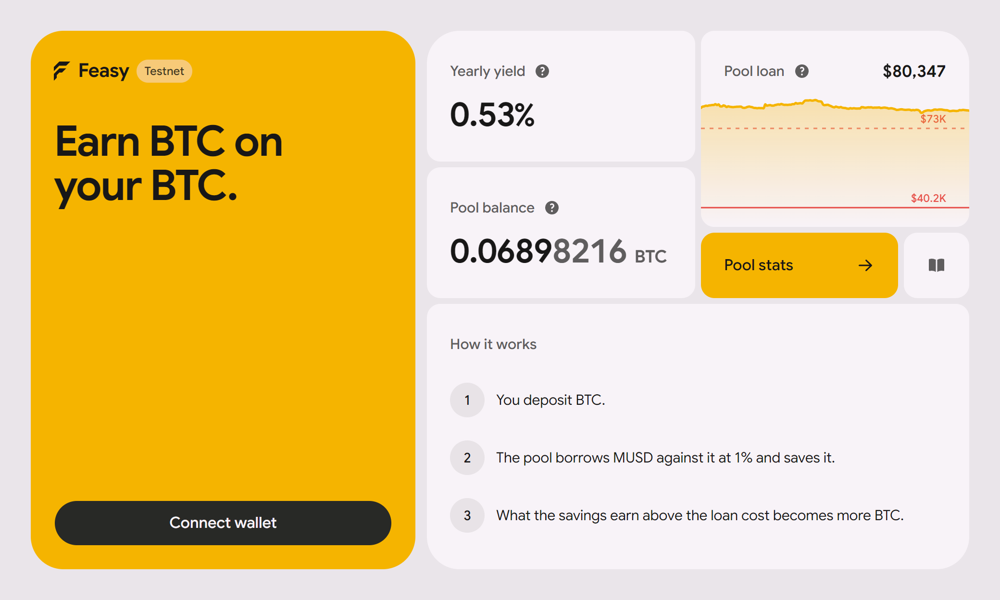
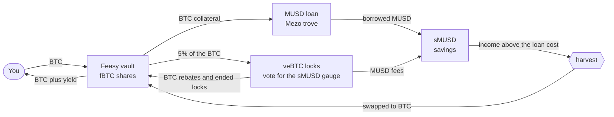
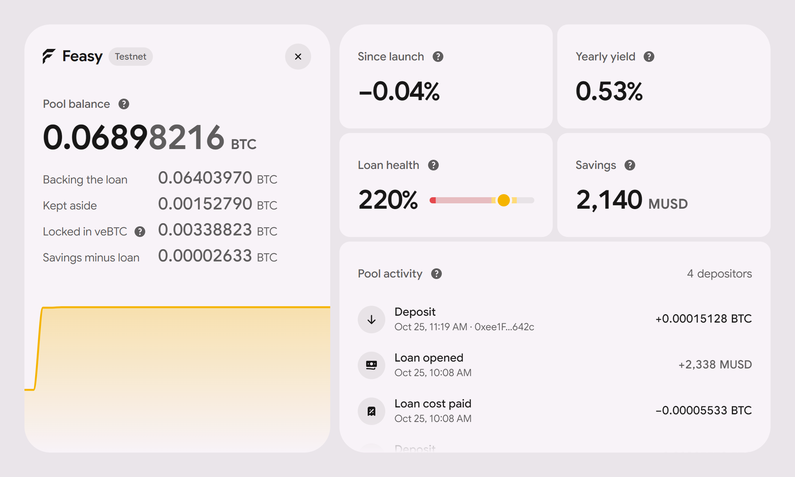
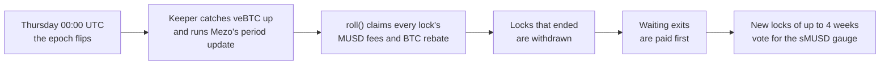
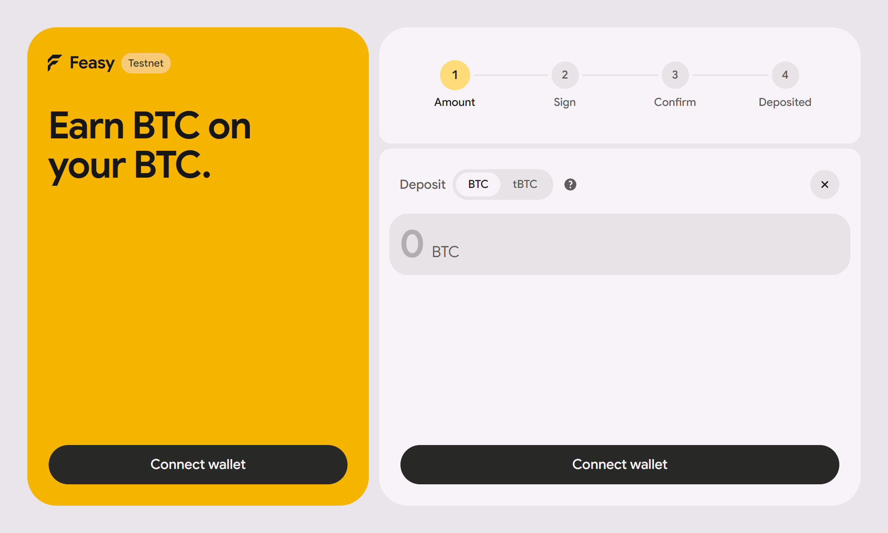
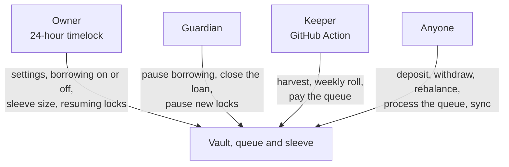

<p align="center">
  
</p>

# Feasy

**Deposit BTC, get more BTC.** Feasy is a BTC savings vault on [Mezo](https://mezo.org). It borrows MUSD against the pooled BTC at Mezo's fixed rate and parks it in the MUSD Savings Vault (sMUSD). The savings income above the loan cost is swapped back into BTC. A small veBTC sleeve also earns the sMUSD gauge's fees. Your exposure stays plain BTC: the borrowed dollars sit in dollar savings, so there is no leverage on BTC.

**[Documentation](https://docs.feasy.org)** · **[Live contracts](#live-on-mezo-testnet)** · **[Run it](#run-it)** · **[Security](SECURITY.md)**

Built for the Mezo buildathon, Track 1 (DeFi). Live on Mezo testnet.

## How it works



1. **Deposit** native BTC or the BTC ERC-20 and receive `fBTC` shares (ERC-4626, priced in BTC).
2. **One shared loan.** `rebalance()` borrows MUSD at Mezo's fixed rate against the pool, holding the collateral ratio in a band (200 / 250 / 300% by design), and parks the MUSD in sMUSD. It buys back the 0.1% borrow fee right away, so the MUSD the vault holds always covers what the loan owes.
3. **Harvest.** Savings income above the loan cost is swapped to BTC on Mezo's DEX, with an oracle-bounded price.
4. **Fair payouts.** New profit reaches the share price linearly over 7 days, so joining just before a payout and leaving right after earns nothing extra.
5. **veBTC sleeve.** Part of the BTC sits in weekly veBTC locks that vote for the sMUSD gauge and earn its fees and Mezo's BTC rebate.
6. **Exits.** Exits are paid instantly from the liquid part. A larger exit waits in a first-come queue that the next released collateral or ended lock pays.

```
raw         = idle BTC + loan collateral + claimable surplus + BTC locked in veBTC
              + (MUSD in savings - MUSD owed) / price
share price = (raw - profit still unlocking) / shares
```

Feasy charges no fee of its own. Holders only bear Mezo's costs: the borrow fee, the loan interest and swap slippage. More in the docs: [how it works](https://docs.feasy.org/how-it-works), [economics](https://docs.feasy.org/economics) and [withdrawals](https://docs.feasy.org/withdrawals).

## Inside the pool

<p align="center">
  
</p>

The pool view on testnet shows where every satoshi sits: backing the loan, kept aside for instant exits, locked in veBTC, and the savings above what the loan owes. It also shows the loan's health against its band and every deposit, loan move and cost as it happens.

## The weekly veBTC roll



The sleeve keeps at most four locks, each ending on a Thursday. Locked BTC counts at face value but can't leave before its lock ends, so `maxWithdraw` only covers the liquid part. Nothing new is locked while an exit waits. The sleeve has no owner of its own and never moves its NFTs, so locked BTC can only come back to the vault. Details: [veBTC sleeve](https://docs.feasy.org/vebtc-sleeve).

## Using the app

<p align="center">
  
</p>

You can deposit in four steps, with native BTC or tBTC, and connect with Mezo Passport or a browser wallet. Withdrawals show what can leave now and turn anything larger into a queued request. A request can't be cancelled, and the app says so before you sign. A position in an older vault version gets a "Move" row that carries it over in two signatures.

## Who can do what



Nobody can move user funds. Every owner call is public for 24 hours before it can run. The guardian can only move the vault toward less risk, and only the keeper's roll can lock new BTC. See [roles](https://docs.feasy.org/roles) and [SECURITY.md](SECURITY.md).

## Live on Mezo testnet

All contracts are verified on Sourcify with exact matches.

| | Address |
| --- | --- |
| Vault v7 (fBTC) | [`0x4DA2eb6942cF136126A630e4C968CE43474c0Db6`](https://explorer.test.mezo.org/address/0x4DA2eb6942cF136126A630e4C968CE43474c0Db6) |
| Withdrawal queue | [`0xB4D13C2A94f9bd165CF77eC5C92D174C51ff13C3`](https://explorer.test.mezo.org/address/0xB4D13C2A94f9bd165CF77eC5C92D174C51ff13C3) |
| veBTC sleeve | [`0xee76C202a9e43988c55DC86816a6c14211Db209B`](https://explorer.test.mezo.org/address/0xee76C202a9e43988c55DC86816a6c14211Db209B) |
| SystemMath library | [`0x34df486c93DB9a2A263498df97BDDF04BF1d57f7`](https://explorer.test.mezo.org/address/0x34df486c93DB9a2A263498df97BDDF04BF1d57f7) |
| Owner, 24 h timelock | [`0xad37d71330152b1bC58e7f87Eba6Ab6a1fE52719`](https://explorer.test.mezo.org/address/0xad37d71330152b1bC58e7f87Eba6Ab6a1fE52719) |
| Guardian | [`0x6CC622e02846f98dCD5a0b33FC35D0F751C7f6dE`](https://explorer.test.mezo.org/address/0x6CC622e02846f98dCD5a0b33FC35D0F751C7f6dE) |
| Keeper | [`0xC05D15b74943e9Ed14001f26D7F4b7db3EeA5a23`](https://explorer.test.mezo.org/address/0xC05D15b74943e9Ed14001f26D7F4b7db3EeA5a23), run every 15 minutes by [`keeper.yml`](.github/workflows/keeper.yml) |

Testnet runs a 2.0 / 2.2 / 2.4 band with a 2% buffer and a 5% sleeve on a 4-week ladder, because the test wallets hold 0.069 BTC and Mezo's minimum loan is 2,000 MUSD. Every transaction, from v1 to the live v7, is linked in [`deployments/testnet-log.md`](deployments/testnet-log.md). Older vaults are retired, and their addresses are in [contracts](https://docs.feasy.org/contracts).

## How it was tested

Forks can't run Mezo, because the BTC token and the price oracle are precompiles. So the testing runs on Mezo itself, with no Mezo contract replaced.

- **Live testnet transactions:** deposits, loan opening, real sMUSD payouts harvested into BTC, queued exits, guardian pauses, ownership handovers and veBTC locks, every one linked in the log.
- **42 live-state scenarios** ([`scripts/preflight.sh`](scripts/preflight.sh)). Each is a single `eth_call` against live Mezo testnet state that injects only Feasy's own code. Together they cover exits, closes, harvests, inflation attacks and the exact precompile budget of every entry point.
- **Price shocks on a private copy of Mezo's MUSD system** ([`staging/`](staging/)): -25%, +50%, -50% and -60% in one block, Recovery Mode, liquidation, redemptions, rate changes and a stale oracle. All 55 v6 checks pass.
- **The veBTC cycle on a local chain** built from Mezo's verified Mezo Earn code, with only the BTC precompile stood in. It steps through Thursdays a testnet can't skip. 17 lifecycle tests pass, an independent check reviewed them, and the tested bytecode equals the deployed bytecode.
- **Coverage, 92 tests:** the vault is at 98.4% of lines and 94.7% of branches, the sleeve at 96% of lines, and the libraries and queue at 100%.
- **Slither:** every finding is triaged in [SECURITY.md](SECURITY.md).

More in the [testing docs](https://docs.feasy.org/testing).

## What we learned building on Mezo

- **20 precompile calls per transaction, and the cap survives `try`/`catch`.** `PriceFeed.fetchPrice()` costs two. Read the price once per transaction and pass it down.
- **Gas estimates come in low** for calls through the BTC precompile. Mezo bills the larger of gas used and half the limit, so a 1.5x pad costs nothing.
- **The loan owes MUSD you never received.** The 0.1% fee and the interest are added to the debt, so buy that gap back right after borrowing, or the last holder to exit is left with it.
- **A paused DEX still quotes.** Check the pool factory's `isPaused()` before trusting `getAmountsOut`.
- **Mezo Earn's public repo is not what is deployed.** Build against the verified explorer source.

The full list is in [Building on Mezo](https://docs.feasy.org/building-on-mezo).

## Mezo integration

| Mezo contract | Used for |
| --- | --- |
| BorrowerOperations, TroveManager | Opening, adjusting, refinancing and closing the shared trove, surplus claims, Recovery Mode checks |
| PriceFeed | BTC price for share pricing and swap limits |
| HintHelpers, SortedTroves | Insert hints for each target ratio |
| MUSD Savings Vault (sMUSD) | Where the borrowed MUSD earns |
| Mezo DEX Router | Harvests (MUSD to BTC) and fee buy-backs (BTC to MUSD) |
| veBTC, Pools Voter | Weekly locks and their votes for the sMUSD gauge |
| Gauge rewards, RewardsDistributor, ChainFeeSplitter | MUSD fees, BTC rebates and the weekly period update |

## Run it

The web app and the docs start from one command with Docker. The app runs on http://localhost:5667 and the docs on http://localhost:5668, and both listen on localhost only, for a reverse proxy such as nginx to publish. Set `MEZO_NETWORK=mainnet` for a mainnet build, and `APP_PORT` or `DOCS_PORT` to change a port.

```bash
docker compose up -d --build
```

The vault scripts need Foundry, Python 3 and `jq`.

```bash
bash scripts/new-wallet.sh ALICE          # wallets land in .env (gitignored)
bash scripts/preflight.sh                 # 42 scenarios against live testnet contracts, no funds needed
bash scripts/deploy.sh                    # deploy + verify, needs a little testnet BTC for gas
bash scripts/vault.sh deposit ALICE 0.1   # native BTC deposit
bash scripts/vault.sh rebalance           # open or adjust the loan (anyone can call)
bash scripts/vault.sh harvest             # savings income to BTC (keeper)
bash scripts/vault.sh withdraw ALICE 0.05
bash scripts/vault.sh request ALICE 0.05  # queue an exit beyond the instant limit, or "all"
bash scripts/vault.sh roll                # weekly veBTC roll, only the keeper's roll locks new BTC
bash scripts/state.sh                     # live vault state, with the sleeve and each lock
bash scripts/keeper.sh 600                # keeper loop: pay the queue, harvest, rebalance, roll weekly, sync
bash scripts/timelock.sh schedule 'setBorrowingEnabled(bool)' false   # owner call, runs after 24 h
```

## Risks

Feasy is **unaudited and runs on testnet only**. The main risks:

- **Mainnet economics.** sMUSD now pays about 1% a year, against a loan that costs about 1.1%, so the loan side roughly breaks even on mainnet today. A mainnet launch waits until that improves, and new vaults deploy with borrowing off.
- **Locked BTC.** Up to the sleeve's share of the BTC is locked for up to 4 weeks. Exits larger than the liquid part wait for the next lock to end.
- **Recovery Mode.** Mezo blocks collateral withdrawals, so instant exits are limited to idle BTC until it ends, and larger exits queue.
- **Liquidation** needs a BTC drop of about 56% with nobody calling `rebalance()`. On staging, a -60% liquidation cost only the 200 MUSD reserve.
- **Mezo's upgradeable contracts.** The vault trusts Mezo's proxies. The sleeve stops new locks as soon as Mezo Earn's wiring changes.

The full list is in [risks](https://docs.feasy.org/risks) and [SECURITY.md](SECURITY.md).
