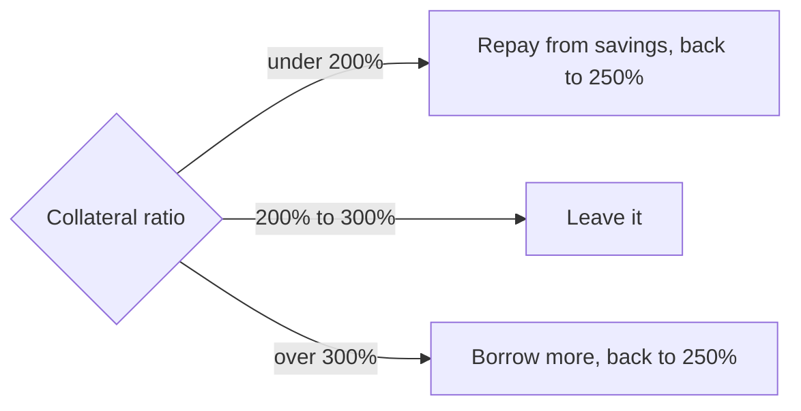

import { Steps } from "nextra/components";

# How it works

The vault runs one cycle. Anyone can push most of its steps. A keeper also runs them on a schedule.

<Steps>

### Deposit

You send BTC, native or the BTC ERC-20. You get fBTC shares at the current share price. The BTC waits idle until the next rebalance.

### Borrow

`rebalance()` adds the spare BTC to the vault's one shared trove. It borrows MUSD at a 250% collateral ratio, so the loan is 40% of the BTC's value. All of that MUSD goes into sMUSD.

Mezo adds a 0.1% fee to every new loan. The vault buys that MUSD back with BTC right after borrowing. So the MUSD it holds always covers what the loan owes.

### Save

sMUSD pays savers from the interest and fees that every MUSD borrower pays. The vault's MUSD earns that rate.

### Harvest

`harvest(maxIn)` sells only the MUSD above what the loan owes, plus a 0.1% cushion. It swaps it into BTC on Mezo's DEX. The oracle price, less the slippage limit, sets the minimum BTC out.

### Unlock

New profit does not jump into the share price. It reaches the share price linearly over 7 days. See [Profit unlock](/economics#profit-unlock).

### Roll

Once a week the keeper rolls the [veBTC sleeve](/vebtc-sleeve). It claims fees and rebates, withdraws the locks that ended, pays waiting exits, and locks again.

</Steps>

## The ratio band

The vault keeps its trove inside a band around a target. It checks the band on every rebalance.

- **Below 200%,** it repays debt from savings. It never sells BTC to do it.
- **Above 300%,** it borrows more. It only does so while Mezo's rate is at most 2%.
- **Near the minimum,** if the loan would fall under Mezo's 2,000 MUSD minimum, the vault closes it.

The design band is 200 / 250 / 300%. The testnet vault runs 220% with a 200 / 240% band, because its wallets are small. The [Economics](/economics) page has the math.

## Who can call what

| Function | Who | What it does |
| --- | --- | --- |
| `deposit`, `mint` | Anyone | Adds BTC, mints fBTC |
| `withdraw`, `redeem` | Holder | Exits up to `maxWithdraw` |
| `rebalance()` | Anyone | Moves the trove back into the band |
| `harvest(maxIn)` | Keeper or owner while the trove is open, anyone once it is closed | Swaps savings income into BTC |
| `sync()` | Anyone | Locks new gains so they start unlocking |
| `processQueue()` | Anyone | Pays waiting exits, freeing collateral if needed |
| `claim(ids)` | Anyone | Sends filled requests' BTC to their receivers |
| `roll()` | Anyone, but only the keeper's roll locks new BTC | Runs the weekly veBTC cycle |

Harvest is restricted while the trove is open. That way nobody can sandwich the swap inside their own transaction. Only the keeper's roll locks new BTC, so a deposit made just before it cannot size a lock.
