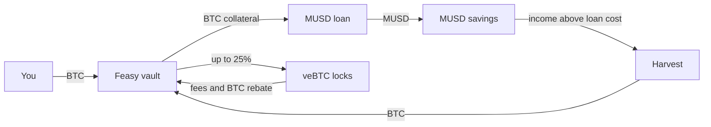

import { Cards } from "nextra/components";

# Feasy

Feasy is a BTC savings vault on [Mezo](https://mezo.org). You deposit BTC and get more BTC back.

The vault borrows MUSD against the pooled BTC. It parks that MUSD in Mezo's MUSD Savings Vault. Then it swaps the savings income above the loan cost back into BTC. A small slice of the BTC also sits in veBTC, voting for the savings gauge.

Your exposure stays plain BTC. The borrowed dollars sit in dollar savings, so there is no leverage on BTC.

## At a glance

| Part | What it is |
| --- | --- |
| Asset | BTC on Mezo, native or the BTC ERC-20 |
| Share token | fBTC, an ERC-4626 share priced in BTC |
| Vault fee | None, no performance, management or treasury fee |
| Loan | One shared MUSD trove, kept between 200% and 300% collateral |
| Savings | MUSD Savings Vault (sMUSD) |
| veBTC | Up to 25% of the BTC, in weekly locks |
| Profit | Reaches the share price over 7 days |
| Owner | A 24-hour timelock |
| Status | Live on Mezo testnet, unaudited |

## Where to start

<Cards num={2}>
    <Cards.Card title="How it works" href="/how-it-works" />
    <Cards.Card title="Economics" href="/economics" />
    <Cards.Card title="Withdrawals" href="/withdrawals" />
    <Cards.Card title="Risks" href="/risks" />
</Cards>

The app lives at [feasy.org](https://feasy.org). The code is on [GitHub](https://github.com/oynozan/feasy).
