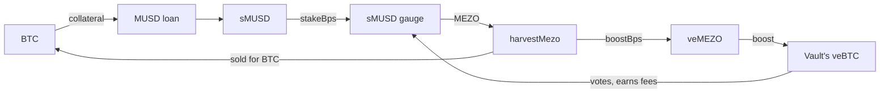

import { Callout } from "nextra/components";

# Savings sleeve and the MEZO loop

v8 keeps its sMUSD in its own contract, [`SavingsSleeve`](https://github.com/oynozan/feasy/blob/main/contracts/src/SavingsSleeve.sol). The sleeve stakes part of that sMUSD in Mezo's sMUSD gauge, which pays MEZO. A second contract, [`Booster`](https://github.com/oynozan/feasy/blob/main/contracts/src/Booster.sol), locks that MEZO as veMEZO and boosts the vault's own veBTC.

## The savings sleeve

The sleeve holds every sMUSD the vault owns.

- **Saving.** On every rebalance, `park()` puts new MUSD into sMUSD, takes a [snapshot](/spread-guard#the-savings-rate) and moves the staked share back to `stakeBps`.
- **Paying back.** When the vault needs MUSD, `pull()` takes loose MUSD first, then accrued yield, then principal. It unstakes from the gauge only when that is not enough.
- **Valuing.** `value()` counts free sMUSD, staked sMUSD, accrued yield and loose MUSD. The vault's `savingsValue()` reads it.

### What staking trades

Staked sMUSD earns the gauge's MEZO emissions. Its MUSD yield goes to the gauge's voters as fees instead, in proportion to their votes. The vault's veBTC votes for the same gauge, so it earns back a share of that yield, in line with its votes.

So `stakeBps` trades some MUSD yield for MEZO. Testnet stakes 20%.

## Harvesting MEZO

`harvestMezo(minBtcOut)` claims the gauge's MEZO. The keeper or the owner calls it.

1. `boostBps` of the MEZO goes to the Booster.
2. The rest is sold for BTC on Mezo Pools, straight to BTC when that pool exists, otherwise through MUSD.
3. The BTC goes straight to the vault, and the next checkpoint counts it as profit.

MEZO has no oracle on Mezo, so the keeper names the sale's floor from the pools' own quotes. MEZO never stays in the sleeve longer than a harvest, so depositors only ever hold BTC.

Testnet sends all MEZO to the Booster, `boostBps` 100%.

## The Booster

- **`lock()`** puts every MEZO the Booster holds into one veMEZO lock. The lock is made permanent right after it opens, so its weight never decays.
- **`boost()`** runs once a week. It votes the veMEZO evenly for the boost gauges of the vault's live veBTC locks on Mezo's BoostVoter. Then it refreshes each lock's boost and its gauge vote.

A boosted lock votes with up to 5 times its weight, so it takes a larger share of the sMUSD gauge's fees. `getBoost(id)` on the BoostVoter reads each lock's boost, where $10^{18}$ is 1×.

The Booster also receives the [performance fee](/business-model). Those shares are protocol revenue that only the owner can move out. The veMEZO lock never leaves.

## On testnet

| What | Value |
| --- | --- |
| sMUSD gauge | [`0xA6972f35550717280f2538EA77638B29073e3F07`](https://explorer.test.mezo.org/address/0xA6972f35550717280f2538EA77638B29073e3F07) |
| Gauge emissions | Over 500k MEZO a week, reset every Thursday |
| Staked share, `stakeBps` | 20% |
| MEZO to the Booster, `boostBps` | 100% |
| veMEZO | Lock 947, 100 MEZO |
| Boost on the two veBTC locks | 1.04× and 1.03× |

The app's pool page shows these live in its Mezo loop pane.

## Safety

- The guardian can `unstake()` every sMUSD from the gauge. Only the owner stakes again.
- If Mezo kills the gauge, staking fails inside a fixed gas budget and the sMUSD keeps earning its own yield.
- The owner sets `stakeBps`, the Booster and `boostBps` through the 24-hour timelock.

<Callout type="warning">
The keeper picks the MEZO sale's floor. A bad floor sells MEZO cheap, but it can only cost MEZO income, never the vault's BTC or MUSD.
</Callout>
