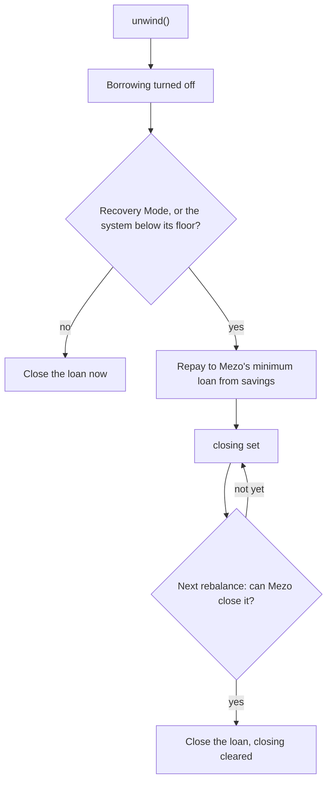

import { Callout } from "nextra/components";

# Recovery Mode unwind

Mezo enters Recovery Mode when its total collateral ratio falls under 150%. In Recovery Mode it refuses to close troves and blocks collateral withdrawals. v8's `unwind()` still takes the vault's loan down at once.

## Before v8

`unwind()` always called Mezo's `closeTrove`. In Recovery Mode Mezo refused it, so the guardian could only pause borrowing and wait.

## In v8

1. `unwind()` turns borrowing off.
2. If Mezo would refuse the close, the vault repays the loan down to Mezo's minimum loan from its savings. Mezo allows repayments in Recovery Mode, since they lift its ratio.
3. The vault sets `closing`.
4. The first `rebalance()` that Mezo lets close the loan closes it and clears `closing`. Anyone can call `rebalance()`, and the keeper does every 15 minutes.

While `closing` is set, spare BTC waits idle and no new debt is taken.

The guardian and the owner can call `unwind()`. If the owner turns borrowing back on, a close that is still waiting is called off.

## What it means for holders

- The loan shrinks to Mezo's minimum at once, so most of the liquidation risk goes with it.
- Exits are still limited to idle BTC until Mezo leaves Recovery Mode, because Mezo blocks collateral withdrawals. Larger exits wait in the [queue](/withdrawals).
- The rest of the loan closes on its own once Mezo allows it.

<Callout>
The app's pool page reads **Closing** in the Mezo loop pane while an unwind waits to finish.
</Callout>

The tests are in [`RecoveryUnwind.t.sol`](https://github.com/oynozan/feasy/blob/main/coverage/test/RecoveryUnwind.t.sol).
