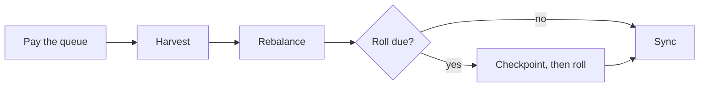

# Roles and keeper

Four kinds of callers touch the vault. None of them can move user funds.

## Roles

| Role | Held by | Can | Cannot |
| --- | --- | --- | --- |
| Owner | A 24-hour TimelockController | Tune the band, buffer, slippage, max borrow rate and deposit cap. Set the keeper and guardian. Turn borrowing on or off. `unwind()` the loan. Set the sleeve's share, cap and ladder. Resume paused locks. Set the fee up to 20%, where a rise waits 30 days. Set the staked share, the spread margin, the Booster and its MEZO share. Move fee shares out of the Booster. | Move user funds |
| Guardian | Its own key | `pauseBorrowing()`, `unwind()`, pause new veBTC locks, raise the spread margin, `unstake()` from the gauge | Anything that adds risk |
| Keeper | Its own key | Harvest while the trove is open. Run the roll that locks new BTC. Pause new locks. `harvestMezo()`, and the Booster's `lock()` and `boost()`. | Move user funds |
| Anyone | Any address | `rebalance()`, `processQueue()`, `claim(ids)`, `sync()`, `roll()`, `snapshot()`, and `harvest()` once the trove is closed | Lock new BTC |

### Owner

The owner is an OpenZeppelin TimelockController with a 24-hour delay. Every owner call is public for a day before it can run. v8's is [`0x2A00…16d6`](https://explorer.test.mezo.org/address/0x2A004C7B97Dbf8096C2331248ABc23CDBc0216d6). The owner's limits are in the contract. Slippage tops out at 5%, the sleeve at 25%, the ladder at 4 weeks and the fee at 20%.

### Guardian

The guardian can only move the vault toward less risk. It can stop new borrowing, close the loan, raise the spread margin and take every sMUSD out of the gauge. In Recovery Mode, `unwind()` repays down to Mezo's minimum loan at once and the next rebalance Mezo allows closes the rest. See [Recovery Mode unwind](/recovery-mode).

A leaked guardian key can cost one borrow fee and one buy-back spread per unwind. That only happens again after the owner re-enables borrowing.

### Keeper

The keeper is a [script](https://github.com/oynozan/feasy/blob/main/scripts/keeper.sh) that runs about every 15 minutes, as a [GitHub Action](https://github.com/oynozan/feasy/blob/main/.github/workflows/keeper.yml) with its own key, separate from the owner.

## A keeper pass

A roll is due when a lock has ended or a new lock is due. If Mezo's weekly period is not updated yet, the keeper calls its permissionless `updatePeriod()` first. It calls veBTC's `checkpoint()` right before every roll.

Anyone else can do most of what the keeper does. The exceptions are harvests while the trove is open and new locks. If the keeper stops, anyone can still rebalance, pay the queue and roll. Harvests and new locks wait for it.
