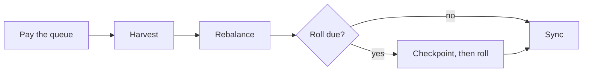

# Roles and keeper

Four kinds of callers touch the vault. None of them can move user funds.

## Roles

| Role | Held by | Can | Cannot |
| --- | --- | --- | --- |
| Owner | A 24-hour TimelockController | Tune the band, buffer, slippage, max borrow rate and deposit cap. Set the keeper and guardian. Turn borrowing on or off. `unwind()` the loan. Set the sleeve's share, cap and ladder. Resume paused locks. | Move user funds |
| Guardian | Its own key | `pauseBorrowing()`, `unwind()`, pause new veBTC locks | Anything that adds risk |
| Keeper | Its own key | Harvest while the trove is open. Run the roll that locks new BTC. Pause new locks. | Move user funds |
| Anyone | Any address | `rebalance()`, `processQueue()`, `claim(ids)`, `sync()`, `roll()`, and `harvest()` once the trove is closed | Lock new BTC |

### Owner

The owner is an OpenZeppelin TimelockController with a 24-hour delay. Every owner call is public for a day before it can run. The owner's limits are in the contract. Slippage tops out at 5%, the sleeve at 25% and the ladder at 4 weeks.

### Guardian

The guardian can only move the vault toward less risk. It can stop new borrowing or close the loan. `unwind()` still fails whenever Mezo refuses the close, as in Recovery Mode. So the guardian pauses first.

A leaked guardian key can cost one borrow fee and one buy-back spread per unwind. That only happens again after the owner re-enables borrowing.

### Keeper

The keeper is a script with its own key, separate from the owner. It runs as a [GitHub Action](https://github.com/oynozan/feasy/blob/main/.github/workflows/keeper.yml) about every 15 minutes.

## A keeper pass

A roll is due when a lock has ended or a new lock is due. If Mezo's weekly period is not updated yet, the keeper calls its permissionless `updatePeriod()` first. It calls veBTC's `checkpoint()` right before every roll.

Anyone else can do most of what the keeper does. The exceptions are harvests while the trove is open and new locks. If the keeper stops, anyone can still rebalance, pay the queue and roll. Harvests and new locks wait for it.
