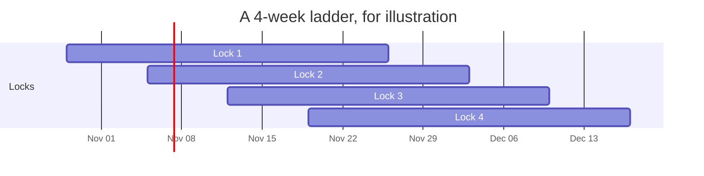

import { Callout } from "nextra/components";

# veBTC sleeve

Part of the vault's BTC sits in veBTC, Mezo's vote-escrowed BTC. Each lock votes all its weight for the sMUSD gauge. That is the gauge that pays into MUSD savings.

The sleeve lives in its own contract, [`VeSleeve`](https://github.com/oynozan/feasy/blob/main/contracts/src/VeSleeve.sol). The vault creates it.

## What it earns

- **Gauge fees.** The sMUSD gauge pays MUSD fees to the locks that vote for it. They go into savings with the rest of the vault's MUSD, and leave through the next harvest.
- **BTC rebate.** Mezo pays veBTC holders a weekly rebate in BTC. It comes straight back to the vault as BTC.

The [Economics](/economics#the-vebtc-sleeve) page has the formulas.

## How much is locked

The owner sets three things:

| Setting | Limit | Testnet |
| --- | --- | --- |
| Share of the BTC, `sleeveBps` | at most 25% | 5% |
| Cap, in BTC | optional | none |
| Ladder length, `lockWeeks` | 1 to 4 weeks | 4 weeks |

The sleeve wants this much more BTC:

$$
\text{hold} = \min\big(s \cdot A_{\text{raw}},\ \text{cap}\big) - \text{locked}
$$

## The ladder

The sleeve keeps at most four locks. They end on consecutive Thursdays at 00:00 UTC. The newest ends `lockWeeks` ahead.

Each Thursday one lock ends. Its BTC comes back, pays waiting exits first, and the rest locks into the newest slot. So an exit above the liquid part usually waits one week, and at most `lockWeeks` weeks.

## The weekly roll

Anyone can call `roll()`. Only the keeper's roll locks new BTC. That way a deposit made just before a roll cannot size a lock.

## Timing on Mezo

- The week flips on Thursday at 00:00 UTC.
- Votes and resets open an hour after the flip and close an hour before the next one.
- A lock that has voted cannot be withdrawn. So a lock that ended is reset first.
- The weekly rebate unlocks only after someone runs `updatePeriod()` on Mezo's fee splitter. Anyone can. The keeper runs it when Mezo has not.

## Why a 4-week ladder

A vote keeps the weight it was cast with until someone pokes it. A longer lock votes with more weight per BTC. On testnet, a 4-week ladder earns about 1.7 to 2 times the fees per BTC of a 2-week one. With only 5% locked, the longer wait rarely matters.

Anyone can poke a vote down to its current weight. Near the end of a week that can cut it by about a third.

## Safety

- The sleeve has no owner of its own. Its NFTs never move. Locked BTC can only come back to the vault.
- Mezo Earn is upgradeable. Before every new lock, the sleeve checks the wiring it was built with. The keeper pauses new locks when any of those contracts change.
- `rebalance()` never calls Mezo Earn. The safety path does not depend on it.
- Each Mezo Earn call runs on a fixed gas budget. One broken call costs only its own lock.
- A lock Mezo refuses to release keeps counting at face value. It emits `RungStuck` and is retried every roll.
- The guardian, the keeper or the owner can pause new locks. Only the owner resumes them. Running locks still end on schedule.

<Callout type="warning">
**Known limit in v7.** A rebate claim that is veBTC's first write after a quiet Thursday flip also pays veBTC's weekly catch-up. That can run past its gas budget, and the roll then skips the rebates. The keeper calls veBTC's `checkpoint()` before every roll, which prevents it. The fix inside the sleeve is built for the next deployment. Only rebate yield is ever at stake, never principal.
</Callout>

The sleeve claims MUSD from the gauge's fee and bribe rewards. The bribe contract also lists MEZO, mUSDT and mFBTC. None were paid in the last three epochs. Any that are would stay unclaimed.
