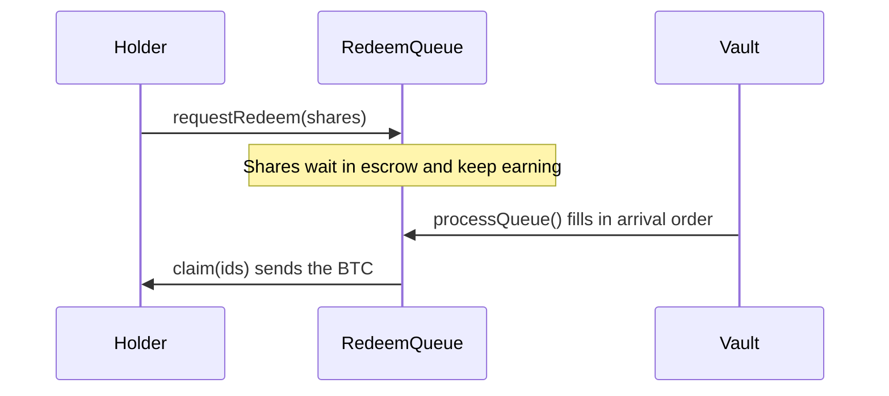

import { Callout } from "nextra/components";

# Withdrawals

Most exits are instant. An exit larger than what can leave right now waits in a queue.

## Instant exits

An exit takes BTC from these places, in order:

1. **The idle buffer.** It holds 3% of the BTC by design, 2% on testnet.
2. **The trove.** The vault releases collateral and repays debt from savings. The ratio goes back to 250%.
3. **Closing the loan.** If the loan would fall under Mezo's 2,000 MUSD minimum, the vault closes it.

Every exit takes a clean pro-rata slice of BTC and MUSD. Take an exit of a share $\varphi$ of the vault. It releases $\varphi C$ of collateral and repays $\varphi D$ of debt, so for those who stay

$$
\text{CR}' = \frac{(1 - \varphi)\, C \cdot P}{(1 - \varphi)\, D} = \text{CR}
$$

Nobody who stays is left holding leverage from someone who left.

<Callout>
`maxWithdraw` and `maxRedeem` move every second, because Mezo accrues interest live. Leave about 0.001% of room when you exit everything.
</Callout>

## When exits are limited

`maxWithdraw` covers only what can leave right now. It shrinks in these cases:

| Case | What happens |
| --- | --- |
| BTC locked in veBTC | Locked BTC counts at face value but cannot leave before its lock ends |
| Mezo's Recovery Mode | Mezo blocks collateral withdrawals, so instant exits are limited to idle BTC |
| Mezo refuses a close | Exits release collateral only down to the line that keeps the trove at target and the system at 150% |
| The oracle is stale | If the price is over 60 seconds old, deposits and exits revert and the `max` views read 0 |

## The exit queue

An exit beyond `maxWithdraw` goes through the [`RedeemQueue`](https://github.com/oynozan/feasy/blob/main/contracts/src/RedeemQueue.sol).

1. `requestRedeem` moves your shares into escrow. They keep earning, and keep their risk, until paid.
2. Requests are paid first come, first served, ahead of instant exits. Each fill pays the share price of that moment.
3. `processQueue()` can free collateral to pay them. Anyone can call it.
4. `claim(ids)` sends each filled request's BTC to its receiver. Anyone can call it. The keeper claims for holders in batches, about 10 to 15 minutes after a fill.

<Callout type="warning">
A request cannot be cancelled. While one waits, the vault takes no new debt and locks no new BTC.
</Callout>

## How long it takes

| Why it waits | Typical wait |
| --- | --- |
| BTC in veBTC | Until the next lock ends, usually one week, at most `lockWeeks` weeks |
| Recovery Mode | Until Mezo leaves Recovery Mode and liquidity returns |
| A refused close | Until the system ratio recovers |

Value per share stays equal for everyone. Only the order changes. In a long restricted state, the earliest requests take the liquid BTC first.
